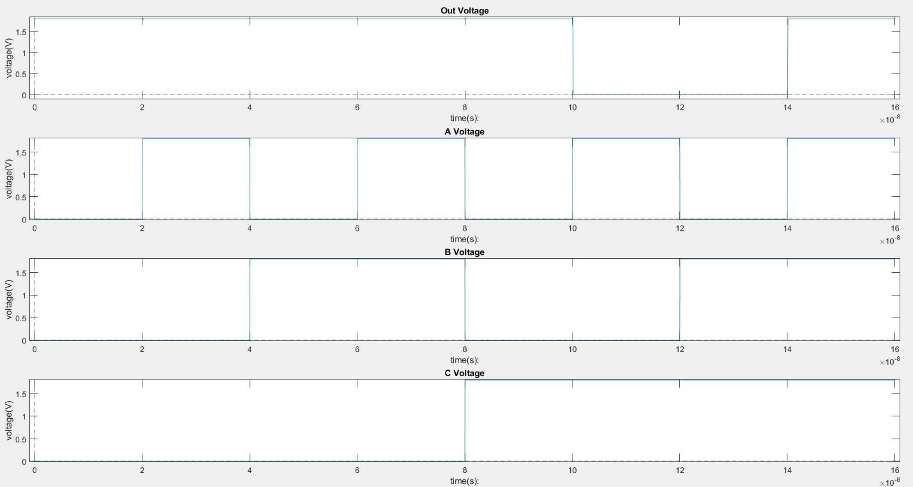
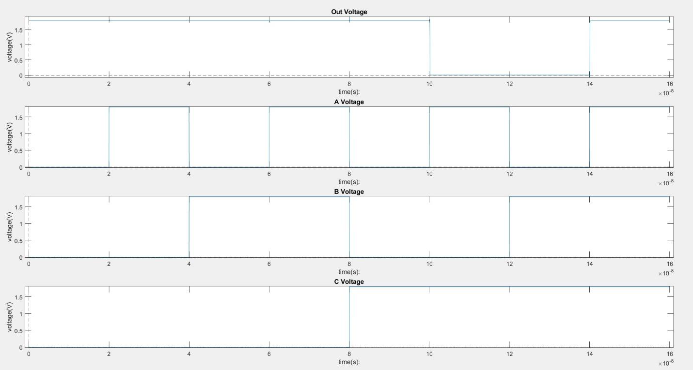
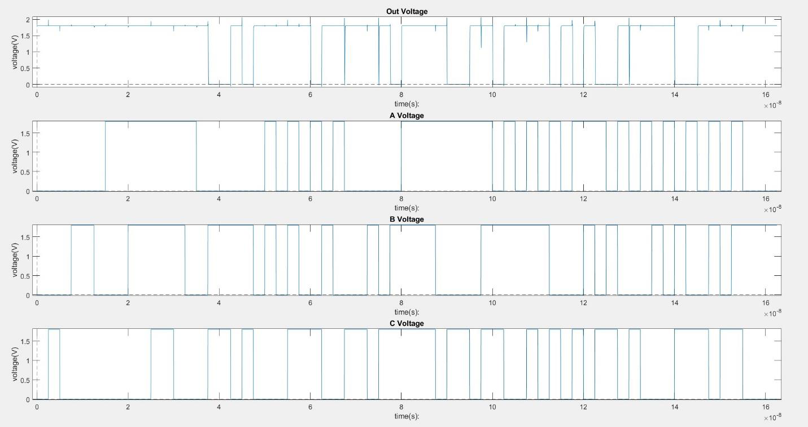
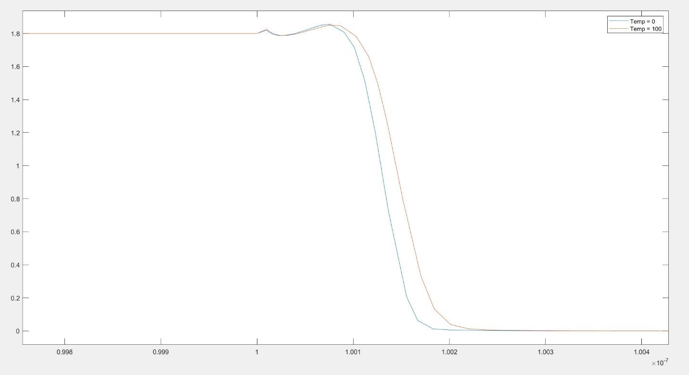
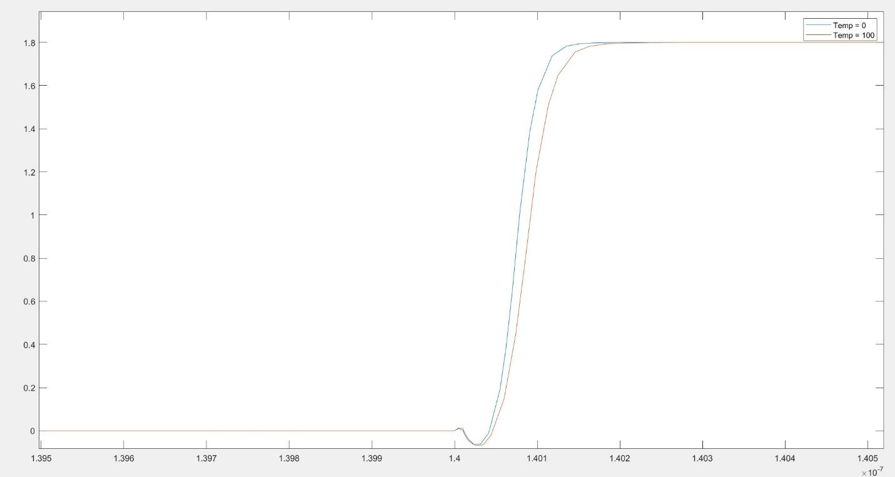

# CMOS XOR–NAND Characterization in HSPICE

Transistor-level characterization of a cascaded XOR–NAND circuit in a 180 nm CMOS model at 1.8 V, examining how transistor sizing and temperature affect propagation delay and power consumption.

The archived simulations compare minimum-width and upsized implementations. Under the recorded test conditions, upsizing increases the measured mean delay from **88.39 ps to 102.24 ps** and switching-window average power from **2.739 µW to 8.181 µW**. For the upsized circuit, increasing temperature from 0 °C to 100 °C raises the measured mean delay from **98.83 ps to 113.45 ps**.

These are archived HSPICE results, not new simulation runs. The decks retain the original electrical implementation; known measurement and implementation limitations are documented below.

## Engineering problem

Larger devices change both drive strength and internal capacitance. This study evaluates the resulting delay and power behavior in a two-stage combinational circuit, then examines its sensitivity to temperature. The objective is to characterize the implemented circuit under explicit stimuli, rather than assume that increasing transistor width improves speed.

The logic function is:

$$X = A \oplus B, \qquad Y = \overline{X C}.$$

The implementation contains an eight-transistor XOR core, a four-transistor NAND stage, and two CMOS inverters that generate the complemented XOR inputs: 16 MOSFETs in total. No explicit output load capacitor or extracted interconnect is included.

| A | B | C | Y |
|---|---|---|---|
| 0 | 0 | 0 | 1 |
| 0 | 0 | 1 | 1 |
| 0 | 1 | 0 | 1 |
| 0 | 1 | 1 | 0 |
| 1 | 0 | 0 | 1 |
| 1 | 0 | 1 | 0 |
| 1 | 1 | 0 | 1 |
| 1 | 1 | 1 | 1 |

## Simulation setup

| Parameter | Minimum-width implementation | Upsized implementation |
|---|---|---|
| Supply voltage | 1.8 V | 1.8 V |
| Channel length | 180 nm | 180 nm |
| Core NMOS width | 220 nm | 440 nm |
| Core PMOS width | 220 nm | 1320 nm |
| Inverter NMOS / PMOS width | 220 / 220 nm | 220 / 440 nm |
| Model section | `mm018.l`, `tt` | `mm018.l`, `tt` |
| Nominal archived temperature | 25 °C | 25 °C |
| Additional temperatures | Not evaluated | 0 °C and 100 °C |
| Delay-deck input transition time | 15 ps | 10 ps |
| Static and switching-deck transition time | 10 ps | 10 ps |
| Transient output interval | 1 ps | 1 ps |

The reference measurement files identify HSPICE `P-2019.06-SP1-1 win64`. Input signals are defined directly with PWL sources; no external vector file is required.

## Functional behavior

The slow input sequence visits all eight states over 160 ns in the order `(A,B,C) = 000, 100, 010, 110, 001, 101, 011, 111`.



*Figure 1. Output and input waveforms for the minimum-width circuit over the eight-state input sequence. horizontal axis: time in seconds, vertical axes: voltage in volts.*



*Figure 2. Output and input waveforms for the upsized circuit under the same state sequence. time in seconds and voltage in volts.*

## Delay and power results

### Transistor sizing at 25 °C

| Metric | Minimum width | Upsized |
|---|---:|---:|
| Selected output falling delay, tPHL | 120.2 ps | 130.3 ps |
| Selected output rising delay, tPLH | 56.58 ps | 74.18 ps |
| Mean of the two selected delays, tPD | 88.39 ps | 102.24 ps |
| Equal-state mean static power | 3.393 nW | 9.090 nW |
| Switching-window average power | 2.739 µW | 8.181 µW |

The recorded upsized implementation has about 15.7% higher mean delay, 2.68 times the mean static power, and 2.99 times the switching-window average power. These results do not establish a general sizing rule: the delay decks use different input slopes, the circuit has no explicit external load, and the body connections require review. Increased internal capacitance is a possible contributor, but its contribution was not isolated by these experiments.

### Measurement definitions

Delay is measured between input A and output Y at 50% of VDD (0.9 V). The selected events occur near 100 ns for tPHL and 140 ns for tPLH. The reported summary uses `tPD = (tPHL + tPLH) / 2`, calculated from the archived measurements. This is not an exhaustive worst-case delay across every input and transition.

Static power is calculated here as the arithmetic mean of `static1` through `static8`, giving each input state equal weight. The measurement windows are 1–20 ns, 20.5–40 ns, 40.5–60 ns, 60.5–80 ns, 80.5–100 ns, 100.5–120 ns, 120.5–140 ns, and 140.5–160 ns. The separate `avgpower` measurement covers the entire 0–160 ns run, including switching events, so it is not used as static power.

The original `DynPow` measurement averages HSPICE's `power` quantity during a denser switching sequence:

```spice
.measure tran DynPow AVG power from=tpd to='155n+tpd'
```

The nominal runs use a fixed `tpd` parameter of 130 ps, producing a 0.130–155.130 ns window. The temperature runs use 145 ps, producing a 0.145–155.145 ns window. This parameter is a manually assigned window offset, not an automatically calculated delay. The denser pattern has a 2.5 ns timing grid; it is not a maximum-frequency test.

`DynPow` is reported as **switching-window average power**, because no leakage or short-circuit component was separately removed. It should not be interpreted as isolated capacitive switching power or as an explicitly measured sum of supply-source powers.



*Figure 3. Upsized circuit output and input waveforms under the denser PWL switching sequence used for the power measurement. Source: report Figure 10, page 6; time in seconds and voltage in volts.*

### Temperature dependence

| Metric, upsized circuit | 0 °C | 25 °C | 100 °C |
|---|---:|---:|---:|
| tPHL | 126.5 ps | 130.3 ps | 142.9 ps |
| tPLH | 71.16 ps | 74.18 ps | 84.00 ps |
| Mean selected delay | 98.83 ps | 102.24 ps | 113.45 ps |
| Equal-state mean static power | 9.098 nW | 9.090 nW | 10.965 nW |
| Switching-window average power | 8.143 µW | 8.181 µW | 8.292 µW |

Between 0 °C and 100 °C, the mean selected delay increases by about 14.8%, mean static power by 20.5%, and switching-window average power by 1.83%. The 25 °C point comes from the separate nominal runs and uses a slightly different switching measurement window. Static power is not strictly monotonic across all three recorded temperatures.

The small relative change in switching-window power cannot be attributed solely to leakage from these measurements. Its absolute increase is 149 nW, whereas the equal-state mean static increase is about 1.87 nW; the two measurements also use different state occupancy and stimuli.



*Figure 4. Output falling edge at 0 °C and 100 °C for the upsized circuit. The higher-temperature transition occurs later. time in seconds and voltage in volts.*



*Figure 5. Output rising edge at 0 °C and 100 °C for the upsized circuit. time in seconds and voltage in volts.*

## Repository contents

| Path | Purpose |
|---|---|
| `netlists/minimum_*.sp` | Minimum-width delay, static, and switching experiments |
| `netlists/upsized_*.sp` | Upsized experiments at nominal conditions |
| `netlists/temperature_*.sp` | Upsized experiments at 0 °C and 100 °C |
| `models/` | Instructions for the external model dependency |
| `results/reference/` | Original `.mt0` and `.mt1` measurement files |
| `results/summary.csv` | Numeric summary derived from those files |
| `results/static_by_state.csv` | Static power for each input state |
| `docs/figures/` | images used in this README |
| `docs/evidence/` | images retained as supporting evidence |
| `docs/technical-review.md` | Implementation limitations and proposed verification work |
| `docs/source-map.md` | Mapping from original archive paths to repository paths |
| `scripts/run.sh` | Batch runner for a local HSPICE installation |
| `runs/` | Generated local outputs, excluded from version control |

## Running the simulations

Use a local HSPICE installation and place the original compatible model at `models/mm018.l`. The model is not bundled; see [model requirements](models/README.md).

From the repository root, run:

```bash
bash scripts/run.sh
```

For a single experiment:

```bash
mkdir -p runs
cd netlists
hspice -i upsized_delay.sp -o ../runs/upsized_delay
```

Run from `netlists/` so the relative model include resolves correctly. Inspect the generated `.lis` warnings and measurement files. Temperature reference files contain 0 °C in `.mt0` and 100 °C in `.mt1`; verify the `temper` field in a new run rather than assuming the suffix mapping.

## Scope and reproducibility

This repository presents simulation evidence, not measured silicon or post-layout signoff.

The original decks tie several transistor bodies to internal source nodes, use repeated temperature/measurement directives, and contain a unitless final PWL time token. These details have been preserved to avoid silently changing the circuit behind the archived results. See the [technical review](docs/technical-review.md) before using the design as a validated reference implementation.

Summary values use the precision available in `.mt0` and `.mt1`; report screenshots and `.lis` files may display additional digits. Device sizing and temperature were studied at the `tt` model section only. Process-corner sweeps, load sweeps, Monte Carlo analysis, and exhaustive timing characterization were not performed.
